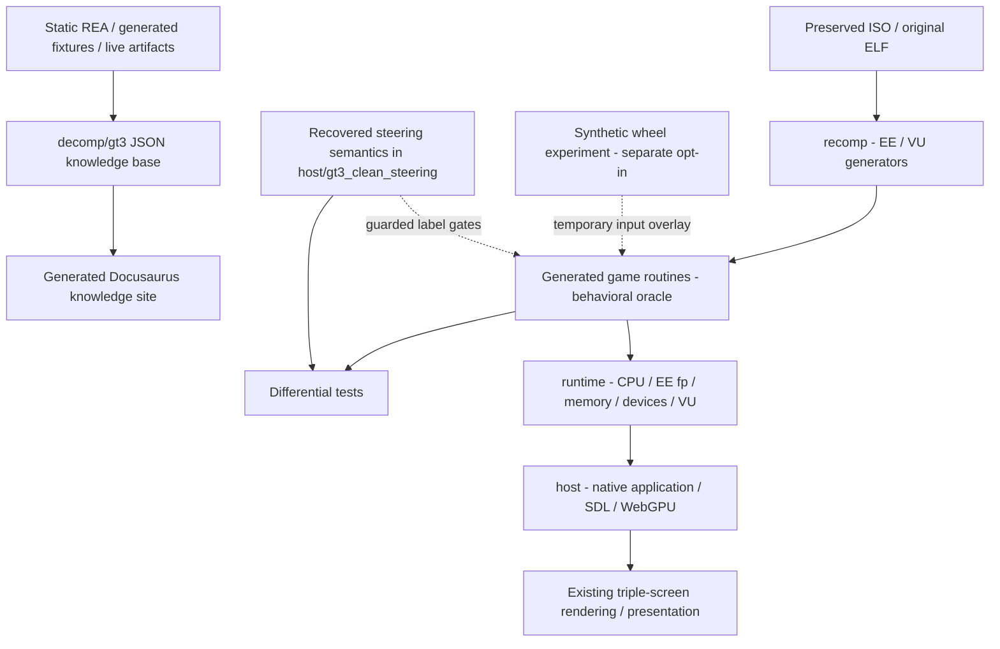
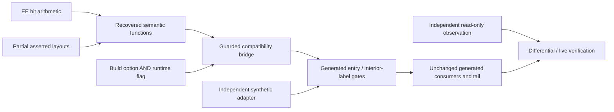

> **Evidence context:** historical private experiment. Current main preserves source and findings; clean steering/synthetic runtime installation is not yet revalidated or enabled here.

---
title: Architecture and boundaries
---

The working tree is deliberately additive. Existing `host/`, `runtime/`, `generated/` and scripts retain their paths. `decomp/gt3/` is the knowledge inventory, **not a competing runtime implementation**.

## Current versus target layering

- **Original generated layer**: game code, simulation, consumers; preserve intact and executable.
- **Recovered semantics**: readable steering math/layouts. Current math and CPU bridge coexist in `host/gt3_clean_steering.cpp`; this is acknowledged historical placement, not falsely claimed complete separation.
- **Compatibility bridge**: guest memory copies, EE numerical behavior, instruction budgets, return state, label gates and fallback guards. Guest objects must not be host reinterpret-cast or padded regions bulk-written.
- **Modernization / host adapters**: future physical input/output translation, explicitly separate from original semantics. The synthetic adapter retains its own seams and observers.
- **Platform / rendering / devices**: runtime and host. No renderer/platform dependencies should enter a future recovered semantic routine.

Direct generated-to-generated calls bypass dispatcher replacement. The steering experiment inserts gates in **copied generated bodies**, not only a function dispatch table. `001E4478` is only partially replaced; classification, curve selection and remaining controls are original. See [steering](steering.md).

Future directory migrations need a separate request and regression proof. Keeping the current build working is more important than an attractive directory tree.
