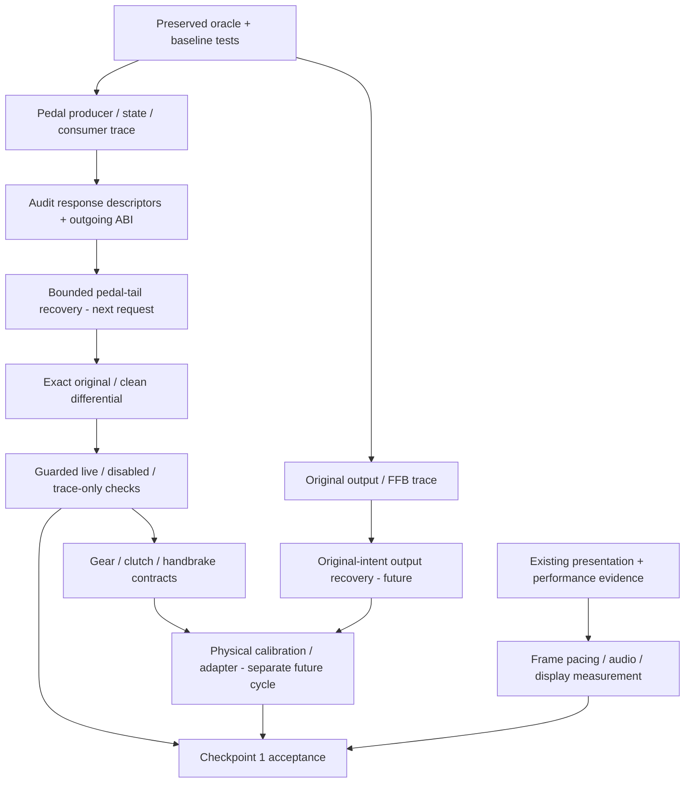

> **Evidence context:** historical private experiment. Current main preserves source and findings; clean steering/synthetic runtime installation is not yet revalidated or enabled here.

---
title: Checkpoint 1 discovery status
---

| Component | Current evidence/status | Next dependency |
|---|---|---|
| Native execution | Working generated runtime, unchanged hardware regressions | Preserve oracle and asset identity |
| Steering | Four bounded clean sites differential/live-validated, frozen | No expansion needed for pedals |
| Throttle/brake | Detailed producer/control/first-consumer trace; 22 original-only fixtures | Prove tail contract and curves before recovery |
| Transmission | Shift command and gear/coupling consumers identified | Trace signed shift, automatic modes, policy/state transitions |
| Clutch | Coupling candidate +139C interacts with brake/shift/handbrake | Establish original control intent; not a physical clutch axis |
| Handbrake | Command +14 -> +13B4 -> rear brake request | Keep original helper/tail; isolate demux and mode effects |
| Wheel hardware | Shipped type IDs/vtable known, no physical report calibration | Recover input contracts first, then separately authorized adapter |
| Original output/FFB | Candidate compute/dispatch/device packet chain found | Verify assembly, intent, units and output packet semantics |
| Triple-screen | Earlier virtual Wayland/WebGPU demonstrated | Stable pacing, real display/audio acceptance still needed |

Discovery does not promote transmission, output or physical controls to recovered status. The [next-cycle queue](queue.md) deliberately gates new work on original contract recovery rather than attractive host APIs. No unrelated handling or rendering change is necessary for the immediate pedal boundary.
