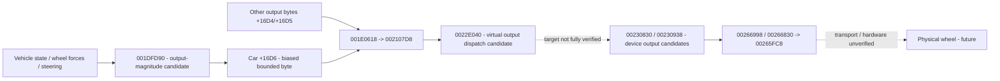

> **Evidence context:** historical private experiment. Current main preserves source and findings; clean steering/synthetic runtime installation is not yet revalidated or enabled here.

---
title: Original output and force-feedback reconnaissance
---

**Do not invent modern FFB.** Discover original intent and serialization first. This is a promising static output-side chain, not proof of hardware output or a complete force-feedback implementation.

## Observations

- Containing function `001DFD90` computes a bounded quantity from vehicle/wheel state and a low-speed steering path, clamps [-1,+1], scales by 127, and writes **car+16D6** with byte encoding **128 - quantized value** modulo 256. Center is 128, +1 encodes 1, -1 encodes 255. This is not certified torque or direction on a real wheel.
- `001E0618` passes **car+16D4** to `002107D8(input,output)` for certain control kinds/suppression states. Existing two adjacent output bytes may serve other device effects; meanings remain unknown.
- `002107D8` guards state near input+130/+138/+13C/+144, emits slots0/1 when allowed, and slot2 only for nonzero wheel-type bits and configuration permission. `0022E040` calls through an underlying object's vtable +24 with a signed this-adjustment at +20. Ghidra omits argument detail; target resolution is not complete.
- `00230830` stores device-related output words; `00230938` and a larger device-update routine assemble/submit packets. `00266998` writes bytes `[F0,00,a,b,c,d]`; `00266830` ORs the first byte with1 then calls `00265FC8`. These are **packet-format observations**, not USB descriptor/protocol certification or a ready host FFB mapping.
- Static strings include `gt_force1/set_gtforce`, `gt_force2/set_gtforce`, calibration labels, FFB enable/disable labels and `multi_steering_force_1p/2p`. `00319FC8` has a retained xref at `0013FFDC`; `00341C58` is used by initializer `00231120`. A string does not identify a branded supported physical device or certify original effects.

Queries at `001E05BC` resolve to a larger containing function; do not treat that interior label as an independent procedure. Lookup `00230F58` failed with no procedure and no returned xrefs; a neighboring byte read is retained. Empty xrefs do not establish no indirect usage.

## Evidence / blockers

Static batches: `ev_9395aaa13532a19b05afec561ea998b7c03989faea05627636704787221af94e`, `ev_ff8997fb8ed6bb85972c73b96ebe4d32812ac88bd4b9d45661ec638e69456811`, `ev_3fe84107b7ecd332f7b5cebfff164bdf138b1f3aaef0a6a7bb6d6c45ce3c85f5`, `ev_165b3c82d776f439e6f9eb8ec234f9c3643f2da7bd56c21118350a38d1144a2f`, `ev_4ef76d60bb0dc49cb12cf462792b364808d21cba69e7e50d832f5cfcff2ff604`.

Remaining: inspect original assembly/call signatures and actual vtable targets, trace all byte producers, configuration strength/disable policy, output timing/rate, device packet transport and host handling. Original pad vibration must not be mistaken for wheel FFB. No output fixtures, live output capture, physical wheel, packet sending, or FFB replacement was added. Hardware integration requires a separate permission cycle after original semantics are evidenced.
