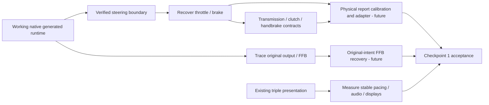
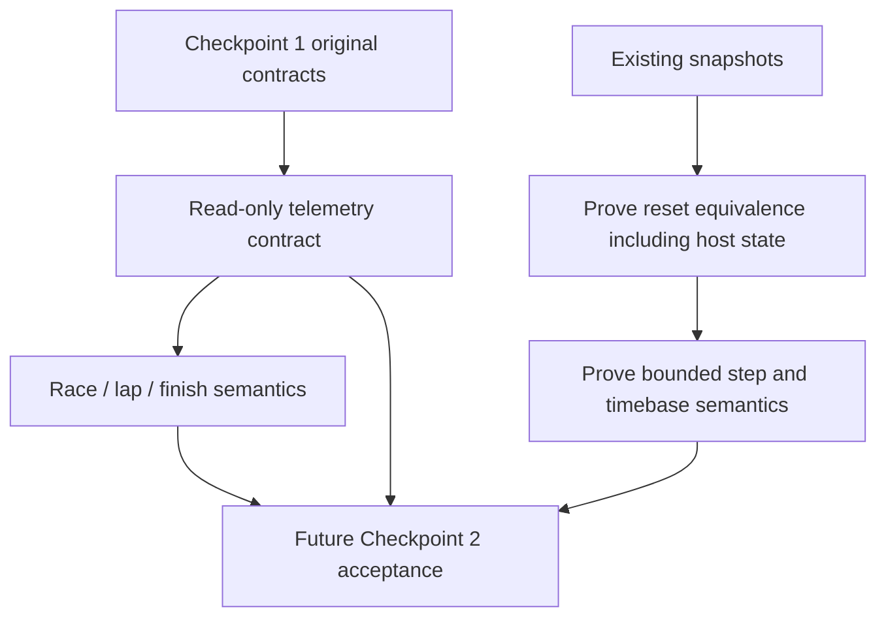

> **Evidence context:** historical private experiment. Current main preserves source and findings; clean steering/synthetic runtime installation is not yet revalidated or enabled here.

---
title: Goals and checkpoints
---

## Checkpoint 1 — usable native racing simulator

A working native GT3 racing experience: original handling, eventual physical controls, recovered original-intent force feedback, triple-screen presentation, stable performance and audio. Present achievements do not establish all these promises.

Physical adapters must be a **separate modernization layer** over recovered original contracts. Do not substitute a generic simulator's pedal, steering or FFB model. Leave unrelated physics and game systems generated.

## Checkpoint 2 — future AI-controllable simulation

Only reconnaissance now: trustworthy telemetry, race-state transitions, reset semantics, controlled stepping, timing and observation. Game state loading and frame counts alone do not prove deterministic episodes. No AI/headless/accelerated simulation implementation is authorized.

## Excluded recovery

Full-game decompilation, general physics rewrite, menus/AI/assets unrelated to checkpoints, Windows, new wheel features tonight, physical-device polling tonight, modern FFB invention, faster-than-real-time or deterministic-control implementation. An interesting address is not authorization to recover it.
