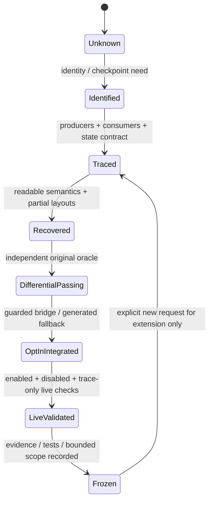

# Recovery workflow

1. Read root rules/handoff and milestone permissions.
2. Choose the smallest explicitly authorized boundary and original profile.
3. Retain original oracle/evidence privately; record IDs, hashes, limitations and source context.
4. Audit contract, partial layouts, incoming/outgoing ABI/FPU and exact dynamic cost.
5. Write readable source and independent original differential tests. Preserve quirks and2e-6 tolerance.
6. Integrate only via isolated default-OFF build/runtime gates with original fallback.
7. Verify enabled/disabled/trace-only live behavior, downstream original consumers, captures and machine dumps.
8. Update selected metadata/curated docs, run source/publication tests, freeze and stop.

Source-only test consistency is not an independent original oracle. Historical frozen records remain contextual evidence, not proof of a new source/runtime port. `just verify-private ROOT` is explicit and strict; `just check` only verifies public consistency and type assertions.

