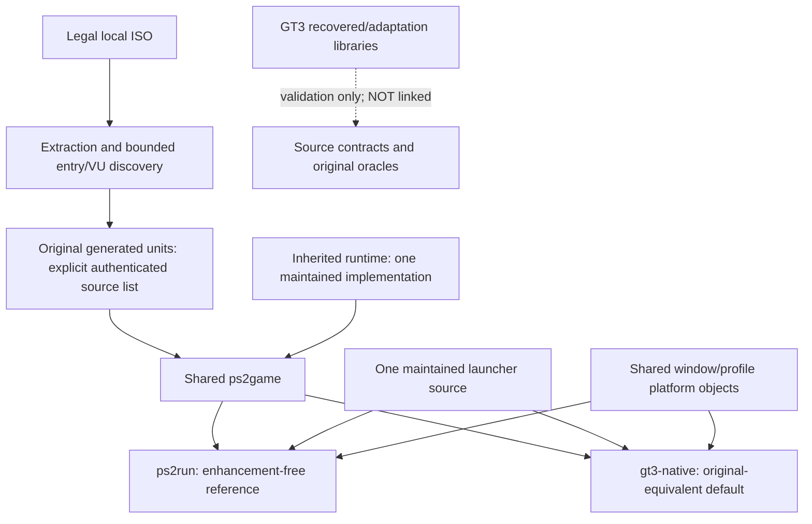
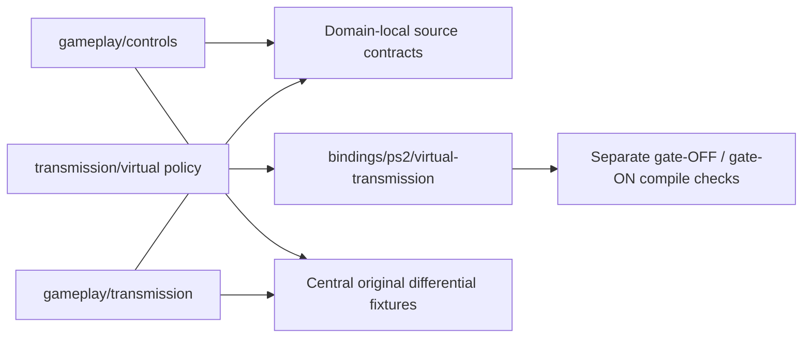
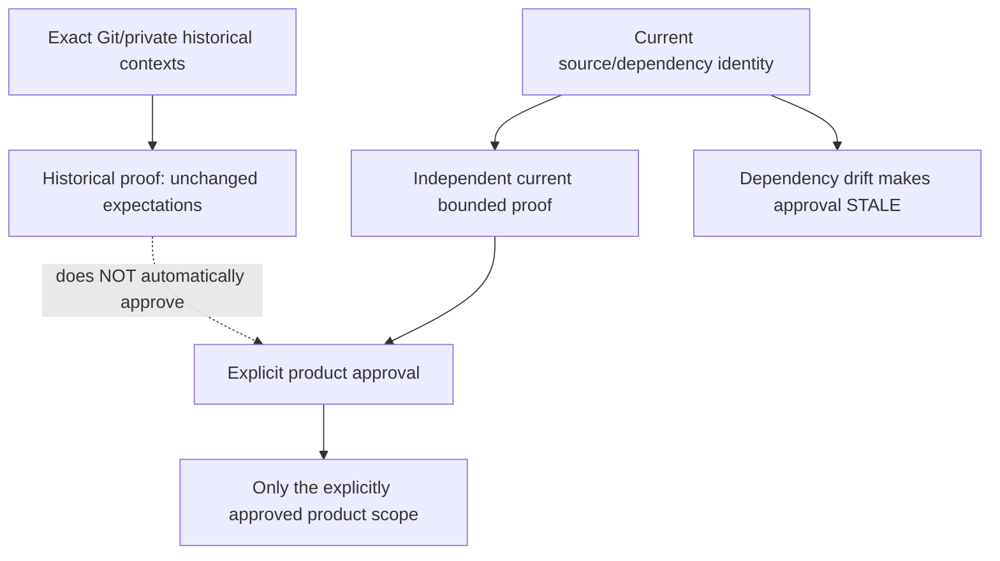

## Current versus intended execution

Both current products initially execute original generated EE/VU code with the
inherited PS2 runtime. **Neither links the readable GT3 gameplay libraries.** The
native executable name alone does not mean PS2-independent execution.

`ps2_native_host` and `gt3_native_host` compile the same maintained `host/main.cpp`
with explicit product definitions. The former excludes inherited GT3 presentation
code; the latter retains its existing opt-in presentation path, inactive by default.
Window/profile source objects are shared. No parallel maintained host/gameplay body
is copied. CMake File API closure and linker maps are recorded for both products;
unapproved recovered/enhanced dependencies are rejected.

The inherited `recomp/`, `runtime/` and generic host internals remain recognizable.
Mixed recovered gameplay/EE bridge files moved intact; they have not been disguised
as newly extracted pure-native implementations.

## Authoritative source and bindings

Controls and transmission own their readable bodies once. Concrete PS2 binding
policy is separate from domain policy. Domain modules are classified in
`project/gt3/implementations.json`; classification is not a demand for duplicate
backends. Steering/pedal/handbrake interior joins are not whole-function recovery;
engine/commit projections are not whole-ABI replacements. Direct generated calls
can bypass dispatch. Downstream original physics remains original.

Future playable and headless hosts consume the **same** authoritative gameplay and
build settings. New hosts/platform layers should be added only when a real approved
consumer needs them, not as empty plugin frameworks or speculative abstractions.

## Authorities, independent proof, integration approval

`project/gt3/` holds the current product/ownership policy, preserved historical
knowledge, source candidate identity, proof records and separate approvals.
Dependencies are deliberately conservative: source/shared build/authority changes
invalidate current approval rather than guessing that an impact is harmless.
A new candidate is not an approval and does not rewrite historical hashes.

Historical verifiers run only through a named, explicit source context. Exact Git
blobs satisfy public-source reads/imports; registered private predecessors satisfy
overlay requirements. Runtime executable/state/evidence reads and their pins stay
unchanged. There is no copied active runtime checkout or installed game hook.

## Validation boundaries

Public source/contracts/site tests need no proprietary files. Explicit private
commands must fail on missing/changed artifacts. Current independent original
fixtures and fresh default product runs are separate from historical native
validation-host/extension runs. Original product matrix rows are re-executed on
both products with exact guest dumps/captures and qualified serialized-state rules.
Only explicitly declared independent fixture recaptures allow the existing compiled
host ABI holes, independently reproduced by the protected original; live driving
continuations remain raw-exact. No expected artifact or guest field is rewritten;
non-product enhanced rows are never relabelled as original defaults.

See [testing](testing.md), [workflow](workflow.md) and the
[execution record](development/restructuring.md) for current gates and limitations.
