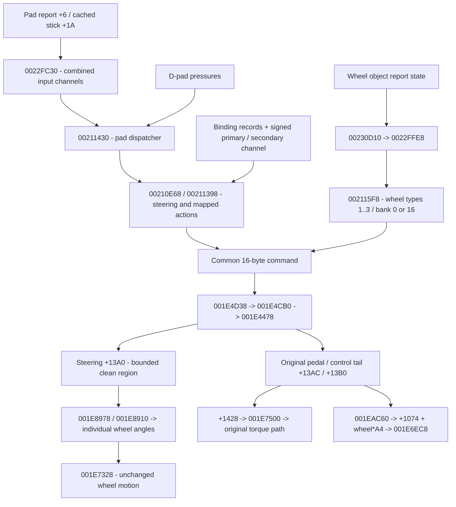

:::note Historical source context

This page preserves findings/instructions from the pre-restructuring context
`aee79fba37937e4dc99dac4263589d005112c504` and its explicitly versioned predecessors.
Paths, Frozen labels and native validation-host results below are **historical**,
not current product integration approval. Use the [current workflow](../developer-guide/workflow.md)
and [execution status](../research/checkpoints/restructuring.md) for maintained commands and actual gates.

:::

> **Reading this map:** addresses identify original-code dataflow, with bounded
> historical recovered implementations described separately. Current bounded source
> proof is not product installation: both products still execute original generated
> gameplay, with no recovered or enhanced gameplay integrated. See
> [execution status](../research/checkpoints/restructuring.md) and [validation layers](../developer-guide/validation.md).

Two wheel joins: shared command, then steering float. Wheel mode 4 does **not** use the stick response/filter; policies 0–3 still slew limits, policy 4 uses the mechanical limit directly. A wheel builder can overwrite centered pad steering; released wheel pedals leave preceding pad commands in place.

Standalone mapping helpers now live at `src/gt3/gameplay/controls/gt3_controls.hpp`
(formerly `host/gt3_controls.hpp`, per `project/gt3/migration-map.json`). They recover
binding lookup and primary/secondary mapped actions. Primary producer `00211050`,
secondary `002111C0`; `00211398` is a distinct inspected control producer, **not**
`fill_mapped_actions`. Normalization's older throwing-zero contract is intentionally
separate from the EE-compatible clean bridge. Relocated sources are not automatically
the exact versions evaluated by historical proof.

The detailed [controls](../research/controls/mapped-actions.md),
[pad trace](../research/controls/pad-steering-trace.md) and
[wheel trace](../research/controls/wheel-steering-trace.md) remain educational references:
report bytes → command representation → processed state → original consumers.
The [clean steering contract](../research/controls/steering-recovery.md) and
[synthetic experiment](../research/controls/synthetic-wheel.md) describe separate
historical validation mechanisms. [Pedal v1](../research/pedals/recovery-v1.md) explains pedal producers,
Q12 versus digital commands, the 22 original-only discovery fixtures and the exact
join contract; [closure](../research/pedals/closure.md) owns later stack admission and finite
profile coverage. [Handbrake](../research/handbrake/recovery-v1.md), [virtual pedals](../research/pedals/virtual-input-v1.md)
and [virtual handbrake](../research/handbrake/virtual-input-v1.md) have separate contracts. No full
controls class, physical report parser or device-output contract is claimed.
