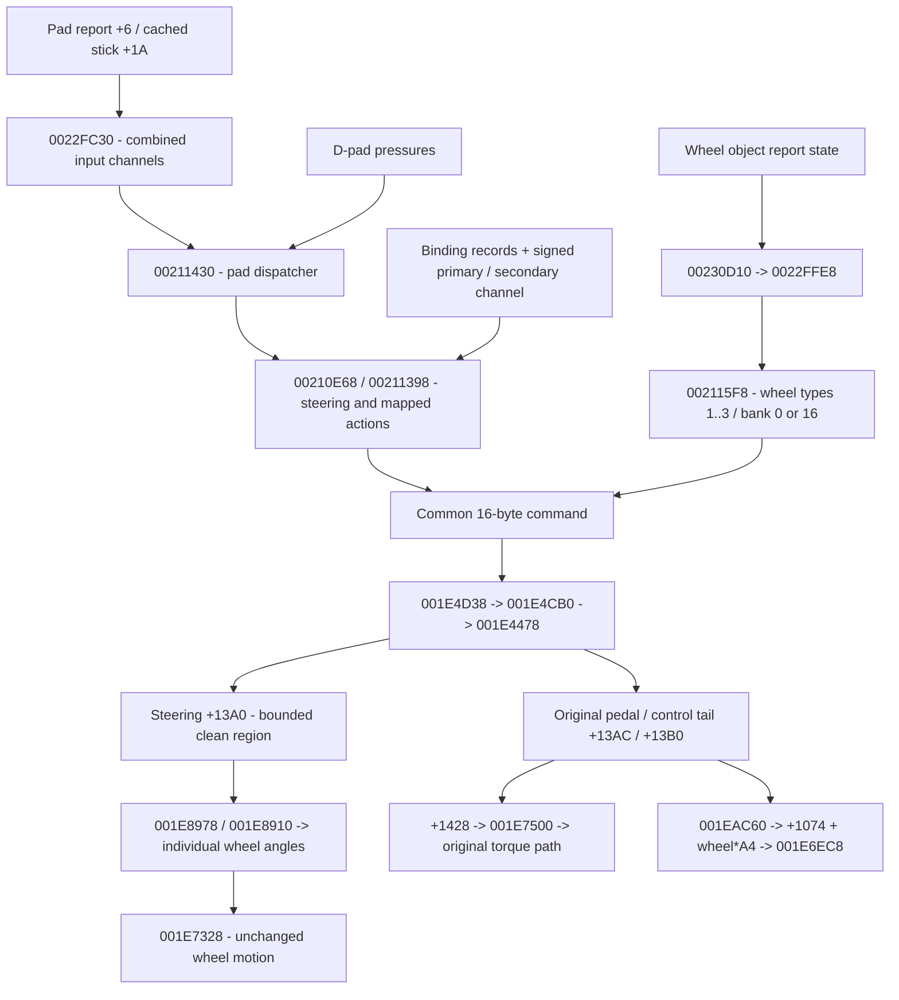

:::note Historical source context

This page preserves findings/instructions from the pre-restructuring context
`aee79fba37937e4dc99dac4263589d005112c504` and its explicitly versioned predecessors.
Paths, Frozen labels and native validation-host results below are **historical**,
not current product integration approval. Use the [current workflow](workflow.md)
and [execution status](development/restructuring.md) for maintained commands and actual gates.

:::

> **Evidence context:** historical private experiment. Current main preserves source and findings; clean steering/synthetic runtime installation is not yet revalidated or enabled here.

---
title: Controls producer / consumer chain
---

Two wheel joins: shared command, then steering float. Wheel mode 4 does **not** use the stick response/filter; policies 0–3 still slew limits, policy 4 uses the mechanical limit directly. A wheel builder can overwrite centered pad steering; released wheel pedals leave preceding pad commands in place.

Earlier standalone mapping helpers in `host/gt3_controls.hpp` recover binding lookup and primary/secondary mapped actions. Primary producer `00211050`, secondary `002111C0`; `00211398` is a distinct inspected control producer, **not** `fill_mapped_actions`. Normalization's older throwing-zero contract is intentionally separate from the EE-compatible clean bridge.

See [retained controls](baseline/gt3-controls.md), [pad trace](baseline/gt3-steering-trace.md), [wheel trace](baseline/gt3-wheel-steering-trace.md), [frozen clean boundary](steering.md) and [new pedal trace](pedals.md). No full controls class, physical report parser or device output contract is claimed.
