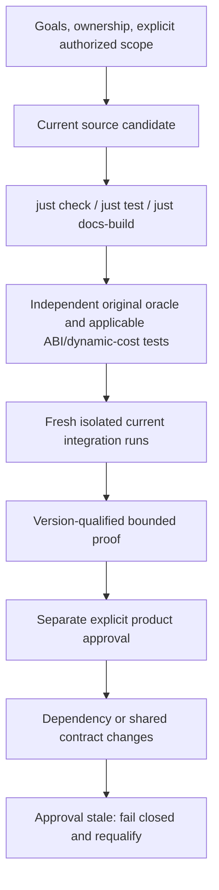

Use the root `justfile` as the single public front door. Old companion justfiles and
bespoke native builders are retired, not maintained as competing integrations.
Exact old recipe/verifier versions remain in Git/private preservation contexts;
they describe their evaluated sources, not commands to revive against this tree.
Use [methodology](recovery-method.md) for the evidence ladder and
[current authorities](../reference/authorities.md) for record semantics.

## Public commands

- `just build` / `just test`: current domain contracts, generic runtime tests and
  preserved authority/reducer negative tests. No ISO required.
- `just check`: current source ownership, candidate/approval dependency identity,
  exact preserved historical metadata, partial-layout assertions and publication.
- `just status`, `just lookup QUERY`, `just evidence QUERY`: current products and
  explicitly historical knowledge queries.
- `just setup`, `just docs-build`, `just docs-dev`: the one Docusaurus installation.
- `just build-game ISO NEW_NAME`: ISO extraction/discovery/regeneration and both
  original products, with authenticated source list and isolated build receipt.

Public success is not private proof or permission to install a recovery.

## Historical verification

`just verify-historical PROFILE EXPLICIT_ROOT` runs a registered exact old source
context, visibly labelled **HISTORICAL ONLY**. Profiles cover original/baseline,
pedals/profiles/admission/closure, virtual pedals, handbrake/virtual handbrake,
transmission/speed/state and extensions. `original` uses the explicitly supplied
original evidence root; other historical identities require the active explicit
root containing their immutable private artifacts.

Public-source reads/imports are scoped to one exact Git revision. Private artifact,
executable, generated-code and state reads stay physical and preserve their hashes.
Missing Git blobs or private predecessors fail. No mutable active-path alias is
accepted as historical source; no runtime hook or copied runtime checkout is
installed. `check-baseline` is a *pre-move* inventory test and should reject the
restructured active tree; that is not a historical evidence failure.

## Current qualification

Current product proof runs **without** the historical source view. It records the
actual build/input/tool/graph identity and fresh outputs. The retained live catalogue
accounts for original-product rows, historical validation-host/extension rows and
explicit retained failures. It does not turn enhanced ON runs into original defaults
or treat historical counts as freshly executed current integration.

Current original-only source oracles compile the relocated authoritative bodies,
with full CPU/RAM/dynamic-cost tests where claimed. Read-only original test-entry/
join units and validation-only gates stay in ignored build outputs, never either
product. Current extension gate-OFF/ON syntax checks are not enabled live evidence.

`just verify-checkpoint REPORT` requires the complete fresh default product matrix
and exact required artifacts. Pilots cannot pass as checkpoint acceptance. Reports,
commands, captures and evaluated build contexts stay ignored. Product approval and
proof records are distinct, conservative dependency closures; changed source/build/
authority inputs invalidate approval rather than silently repinning it.

## Change and rollback discipline

Do not bulk add/reset/stash/clean, rewrite old hashes, weaken comparisons, conceal
failed attempts, or overwrite source from an archive. Make dependency-aware changes
within the authorized scope. Preserve the evaluated context and unique private
inputs needed for active verification; regenerate disposable outputs rather than
creating new archives or preservation workflows. Donor patches restore changes
against exact historical bases, not wholesale integrations; see
[provenance](../research/provenance/index.md). Git provides source history.

Any new recovery, modernization, headless API, hardware adapter, FFB or enhancement
integration requires separate bounded authorization. Queue entries are not permission.
