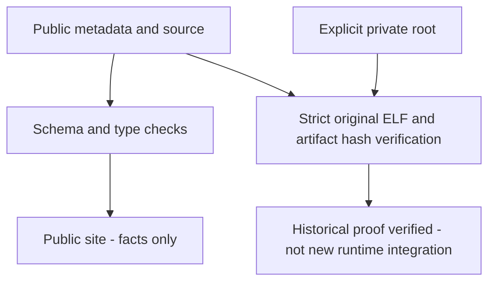

## Selected original findings

Public authorities: [manifest](/knowledge/manifest.json),
[symbols](/knowledge/symbols.json), [types](/knowledge/types.json) and
[provenance](/knowledge/provenance.json).

They contain factual selected findings and references/fingerprints, not raw
original program data or assembly/decompiler bodies. The original provenance set
contains eleven private artifacts and 66 static evidence IDs linking to retained
private records. Its `snapshot_context` identifies the preserved b6482fb experiment;
later baseline, pedal and transmission authorities have separate evaluated
contexts. These historical populations are not current product integration proof.

`just check` checks public consistency and partial layouts without private files.
`just verify-private ROOT` strictly checks the retained original ELF, artifact
hashes and evidence IDs in an explicit private root. Missing or changed data fails;
never rehash to conceal it. Docs generation copies public authority JSON, not raw
exports. Neither these checks nor the publication guard certify copyright,
clean-room derivation, distribution rights or all Git history.

## Donor experiments are restoration sources, not integrations

The project inherited upstream recompilers, runtime, renderer and browser
infrastructure, with Git history, licenses/notices and reviewed fixes retained.
Authored experiments also supplied distinct categories of work:

- Controls/steering recovery, synthetic adapters, opt-in build/CLI/probe source
  and fixtures from the resolution experiment.
- Performance, presentation and LAN/input experiments, with separate
  window/render/probe changes and non-repository harness scripts.
- Initial bring-up, validation/reproduction and contribution-baseline variants;
  many fixes already have newer upstream equivalents.

A donor restoration patch describes staged/unstaged tracked changes and untracked
authored source **against its exact recorded base**. It is not a patch to apply
wholesale to the active tree. Compare feature deltas and newer upstream equivalents
before any separately authorized integration. Historical scripts may depend on
sibling directories or pinned archives; they are not current profiles. A historical
claim that a service was running is not evidence of current service state, and
rejected optimizations remain rejected.

Retained private executables, evidence and original inputs are independent of the
active source checkout. Historical success does not install a recovery or approve
an enhancement. Use [current authorities](reference/current-authorities.md),
[workflow](workflow.md) and [publication policy](development/PUBLICATION.md) for
maintained boundaries; do not publish raw donor evidence or machine/session data.

## Public/private verification split

