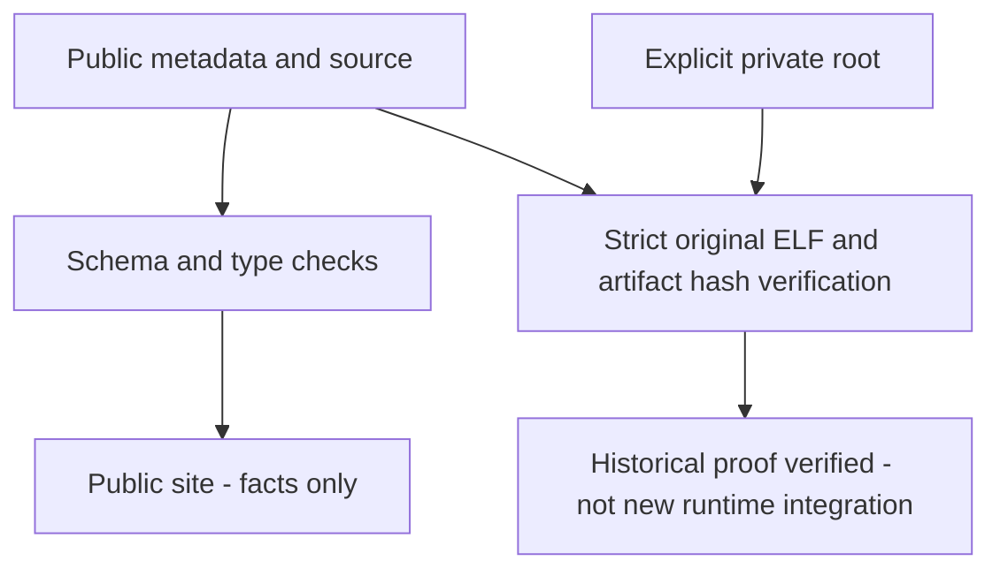

:::note Historical source context

This page preserves findings/instructions from the pre-restructuring context
`aee79fba37937e4dc99dac4263589d005112c504` and its explicitly versioned predecessors.
Paths, Frozen labels and native validation-host results below are **historical**,
not current product integration approval. Use the [current workflow](workflow.md)
and [execution status](development/restructuring.md) for maintained commands and actual gates.

:::

# Provenance and evidence boundaries

Public authorities: [manifest](/knowledge/manifest.json), [symbols](/knowledge/symbols.json), [types](/knowledge/types.json), [provenance](/knowledge/provenance.json).

They contain factual selected findings and references/fingerprints, not raw original program data or assembly/decompiler bodies. All eleven original artifacts are private.66 static evidence IDs link to retained private records. `snapshot_context` states that validation occurred in the preserved b6482fb experiment; current main recovery source is not runtime-installed.

`just check` checks schema/relations/types without requiring private files. `just verify-private ROOT` hashes every required artifact, verifies the original ELF identity and checks retained evidence IDs. Missing or changed data fails; never rehash to conceal it. Docs generation copies only public knowledge JSON—not raw exports. The publication guard is a guardrail, not copyright/history certification.

## Public/private verification split

