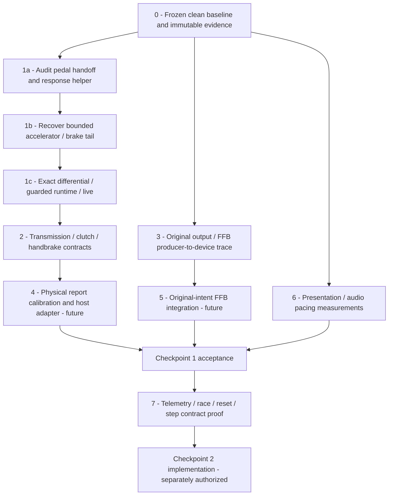

:::note Historical source context

This page preserves findings/instructions from the pre-restructuring context
`aee79fba37937e4dc99dac4263589d005112c504` and its explicitly versioned predecessors.
Paths, Frozen labels and native validation-host results below are **historical**,
not current product integration approval. Use the [current workflow](workflow.md)
and [execution status](development/restructuring.md) for maintained commands and actual gates.

:::

> **Historical proposal, not work authorization.** This accumulated queue records earlier priorities and separately scoped outcomes. “Latest,” “next,” “current,” Frozen labels and imperative instructions below belong to those cycles; they are not today's status, blockers or permission to execute.

Use [current authorities](reference/current-authorities.md),
[continuation](development/continuation.md) and the root `justfile` for maintained
status and commands. The present products do not integrate recovered gameplay.
Old `decomp/` paths and validation-host installation instructions identify their
evaluated historical contexts, not active product features. Later pedal,
handbrake and transmission findings do not reopen this proposal or authorize
adjacent work.

## Recorded priority graph

The graph is the original proposed dependency order, not an approved current plan.
Its “immutable evidence” wording is historical, not a requirement to create new
preservation machinery.

## Historical virtual throttle/brake outcome — stop {#latest-virtual-throttlebrake-input-proven--stop}

The separately authorized [virtual pedal experiment](virtual-pedals.md) proves
constant/scheduled normalized commands through the unchanged GT3 pedal and original
vehicle path, with original-vs-adapter/Frozen oracle, native-v3 live and unchanged
regressions. It does not reopen Frozen Pedal v1 or authorize physical calibration,
DriverInput, canonical integration, clutch/handbrake/transmission/coupling/FFB,
hardware or AI/reset/step work. **Stop at this bounded experiment.**

## Prior: observed-context discovery/admission closed

The separately authorized [closure](pedal-closure.md) proves the unchanged body at
all4,199 actual survey entries and4,199 guarded substitutions, zero fallback, across
all14 representative runs /five processing classes. Time Trial/Free Run/B-1 use
the same stack-local layout with a proven16-byte mode-caller frame difference.
Structural admission replaces the one-address exception; all fresh native/live/
public/private gates pass. **Re-frozen, validation-only; stop.**

No unsupported **observed** processing class remains. This is not universal mode/
car/calibration/thread/long-session coverage or physical hardware proof. No new
pedal API, canonical installation, adjacent subsystem or next recovery is authorized.
The older stopped records below remain historical, not current blockers or work orders.

## Prior read-only admission audit outcome

The separately authorized [49AF40 audit](pedal-admission-49af40.md) established
stack-local command ownership and bounded original/fallback equality, **not safe
admission or actual-context clean-body equivalence**. It stopped without a guard
change. Remaining ownership/indirect-hook and exact ABI/cost/mutation/live proof
obligations are not authorization to execute another cycle or any adjacent work.

## Earlier descriptor/profile characterization outcome

The separately authorized finite survey, whose [matrix is retained with closure](pedal-closure.md), **stopped** on
Time Trial: 299 original entries / 0 replacements / 299 protective fallbacks,
command0049AF40 rather than the previously audited0049AF50 context. Four earlier
pairs passed1,200 substitutions; remaining pairs and full native regressions were
not run after stop. No Frozen change. A possible future bounded command/alias
admission audit requires explicit authorization; it is not permission to modify
guards, recover adjacent systems or resume gameplay validation automatically.

## Pedal Recovery v1 continuation outcome

The [stopped audit](pedal-recovery-v1.md) and [native baseline](current-baseline.md)
were followed by an explicit user-authorized [Pedal v1](pedal-v1.md) continuation.
Its exact original/clean ABI/cost, wrapper/consumer and native-v3 live checks pass.
The boundary did not widen; canonical ps2run remains generated-only. All final
gates pass; the bounded validation-only implementation is **Frozen**, recorded in
`decomp/gt3/pedal-validation.json`.

**This prior Frozen checkpoint remains closed.** Its later separately authorized
characterization stopped as recorded above; no adapter or neighboring subsystem
work follows automatically.

## Historical authorized proposal: pedal semantics only

**Need:** recover the original accelerator/brake contract before any physical-pedal adapter. Steering is already sufficient and frozen. No new device features required.

**Exact candidate target:** interior **`001E48FC–001E4BA7`** of `001E4478`, resume **`001E4BA8`**. Audit all branch/delay-slot paths and outgoing register state before installation; if a complete contract cannot be shown, stop instead of widening the target. That original proposal is now completed in the isolated validation host only; it does not authorize a broader replacement.

**In scope:** accelerator/auxiliary arbitration required by this region, digital slewing, analog nonzero floor, mode4 response evaluation, prior control-state bytes, writes to car+13AC/+13B0 and control-state +0/+2, exact dynamic EE cost, relevant FPU state, `v0 = uint16(car+14BA)` at resume, and the computed policy in `s1` for the later `001E4180` call. Represent unknown policy values neutrally. The original prefix supplies control kind/context; do not infer human-facing mode labels from numeric values.

**Dependencies to audit first:**

1. Original assembly/generated instructions, retained REA record `ev_1ae7e5b58f8018c49aa9ed4a976e3984f3dda1001e36148fc94cff18145abd71`.
2. Descriptor helper **`001D92E0`** and live descriptor data **0049D060/70**; determine EE behavior for identity, quadratic, square-root, negative inputs, NaN-like/denormal/invalid states and optional derivative writes. Either keep its calls original in the bridge, or obtain explicit approval for a separately bounded standalone reconstruction. Do not silently replace a general math routine.
3. Tables/constants **002D4930/34/38/3C**, **00352990**, policy bytes +136D/+13E5 and suppression +14B8/+14BA, command flags 2/4/8, unsigned accelerator/auxiliary representation versus signed brake.
4. Typed **partial** pedal state with padding and every used offset asserted; observations currently lie inside steering padding and authorize no writes.
5. Resume ABI/budget: generated tail expects suppression value in `v0` and policy in `s1`; preserve shift/handbrake/coupling/epilogue and every other genuinely consumed outgoing value. Exact cost must account for original helper calls, branch/delay-slot choices and any bridge observation seams.

**Differential matrix before any integration:** zero/released/low/full pressure; boundary raw47/48,52/53,174/175,179/180; bank0/16, wheel types0–7; combined pad/wheel released-command persistence; flags2/4/8; command halfword extremes and wrapping; all observed policy values including0/1/2/3/5/6 and unsupported persistence; prior accelerator/brake and state bytes; digital rise/fall/clamps across frames; identity/quadratic/sqrt descriptors and signed/zero/invalid EE numeric inputs; suppression counters and analog-zero special behavior. Compare relevant memory, neighboring padding, control-state bytes, PC/SP, callee-saved state, FPU flags and exact budget. Use the original generated whole routine/tail as independent oracle, not a shared helper expectation.

**Integration only after pass:** separate copied generated build, build+runtime default-OFF opt-ins, profile/address/layout guards, fallback to generated outside evidence. Preserve original steering gates and synthetic adapter independently. Add explicit substitution counters for the new region, not just output observations.

**Live acceptance:** new evidence directory/disposable cards, identity-pinned snapshot, original versus clean runs with existing pad throttle/brake sequences (press, release, alternating and combined), enough state observation to distinguish pre-helper versus post-helper brake, car+1428 and unchanged engine/wheel consumers. Compare semantic traces, every capture, final car and complete dumps; disabled and trace-only must remain baseline-identical. Do not add synthetic pedals or physical polling to make validation easier. Preserve existing **2e-6** tolerance; do not weaken assertions or existing digital/analog tests.

**Excluded:** shift dispatch `001E4BA8`, handbrake `001E4BB8–001E4C5F`, coupling helper `001E4180`, wrapper/engine/torque/axle consumers, physical wheel/pedal/shifter/clutch/FFB, AI/reset/step/performance/renderer changes. Missing live calibration is a discovery task, not permission to tune curves.

**Stop gate:** bounded evidence+tests+guarded live validation documented, manifests updated, handoff written; or stop earlier with explicit unknowns if contract/ABI proof is incomplete. No automatic next subsystem.

## Historical suggestions for following discovery cycles {#following-discovery-cycles}

These were suggestions at that checkpoint, not a current work queue. Subsequent
bounded results and permissions must be read from their separate authorities.

- Transmission first: command shift → control-state → ratio/state/coupling, automatic/manual/neutral/reverse intent, then handbrake interactions.
- Output-side original FFB trace runs independently of input math; verify virtual targets and packet transport before host mapping.
- Physical hardware calibration/integration and pacing/audio acceptance remain later separately authorized Checkpoint1 work.
- Checkpoint2 telemetry/race/reset/step proof stays low priority until Checkpoint1 contracts and operation are stable.
