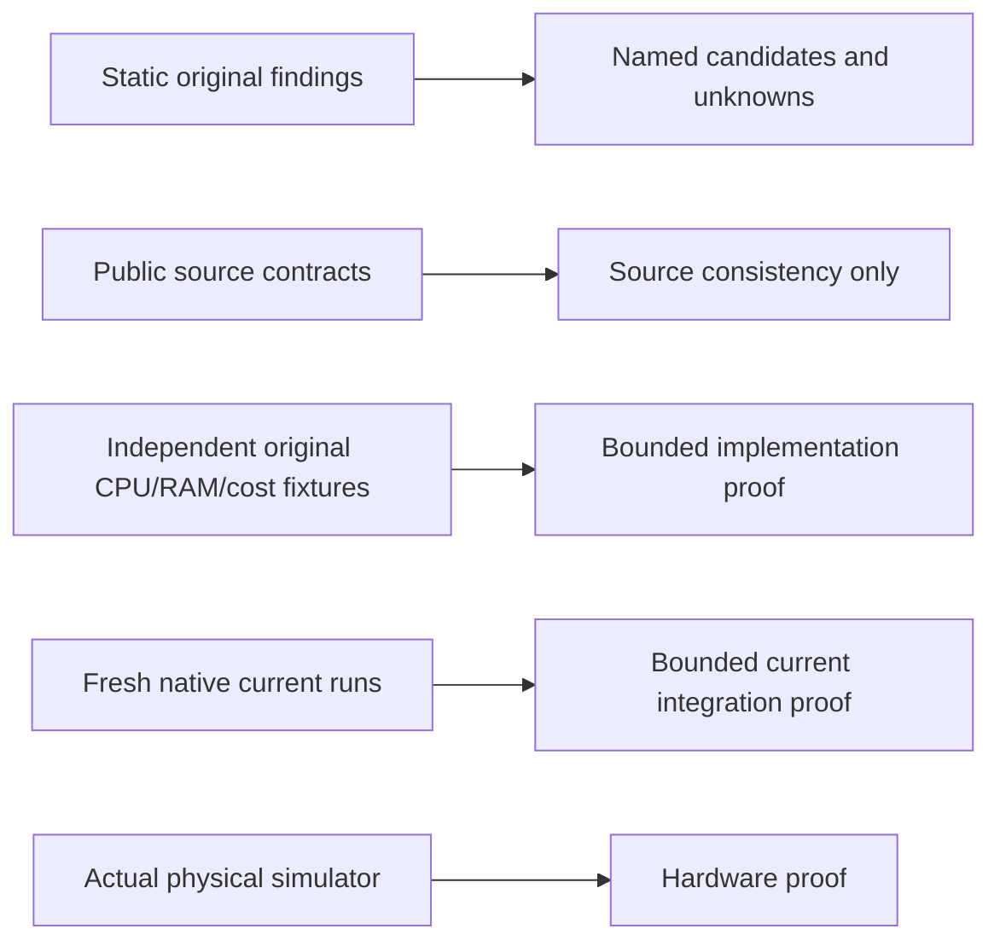

## Public checks

`just check`, `just test` and `just docs-build` need no proprietary artifacts.
Software-runtime tests compile independently of the downloaded GPU SDK. Source
contracts keep assertions active even in Release. Historical reducer/authority
negative tests load their exact historical public context; relocated C++ protocol
fixtures compile the current source paths. Current ownership/approval tests run
separately without that source view.

These are distinct evidence classes. None implies all-game compatibility or all-car/
policy/thread coverage. Partial state-decision projections are not whole-engine ABI
replacements. Interior gates are not whole-function recovery. Preserve EE FP bit
patterns, integer wrapping/signedness, zero/invalid quirks and the existing `2e-6`
tolerance; downstream original physics remains unchanged.

## Optional current original fixtures

An explicit `GT3_ORIGINAL_ELF` CMake request requires an existing supported original
ELF **and** original `PS2_GENERATED`. Missing/changed protected inputs fail. Build
`gt3_original_differentials` and run CTest label `original-differential` in the
qualified product build. Targets include current controls/steering/wheel, pedal
join, handbrake join/transitions, selector, speed/helper and admission/state models.
Virtual pedal/handbrake three-phase fixtures compare original packet injection,
adapter and actual existing gated substitution against original CPU/full-RAM results.

The fixture unit generator changes only names, explicit original test entries,
join stops and existing validation-only gates/read-only probes. Generated bodies
remain private; neither oracle nor gated fixture is linked into a product. These
are renewed current-source differentials, not evidence that recovery is installed.

## Retained historical proof

`just verify-historical extensions "$PWD"` re-executes the full retained inherited
oracle chain and validates its pinned native evidence, including extension OFF/ON
contracts. `just verify-private EXPLICIT_ORIGINAL_ROOT` verifies the original donor
scope. Missing/changed required artifacts fail. No historical source hash is updated
to make a relocation pass. These commands are visibly historical, never current
product acceptance.

## Fresh original product matrix

`matrix.py` catalogues every retained row from explicitly pinned accepted authority
manifests. Broader manifests also preserve rejected controls: those are named as
failures, not admitted by removing the capture requirement. Original-product rows
are re-executed on **both** products; historical validation-host/extension rows are
explicitly not current product runs, because neither product installs those gates.
Do not claim newly qualified extension ON/native integration from this matrix.

Each current original row must reproduce exact complete EE/IOP/SPU dumps and the
full scheduled capture set. Ordinary live driving continuation states compare
all bytes exactly. The 22 explicitly declared independent fixture-creation/recapture
selectors use the *existing*, compiled kernel-thread ABI-hole rule, including menu
fixture creation after a load. An unchanged protected-original repeat independently
reproduces those raw padding differences. `project/gt3/matrix-contract.json` pins that
control and the exact selectors; it is not a general exception for loaded states.
No guest bytes or defined serialized fields are ignored; no snapshot or expected hash
is rewritten. Negative tests reject both live-state padding differences and any
changed defined fixture field. The existing `2e-6` limit is unchanged. New outputs never overwrite retained inputs or failed attempts.

The existing external CD/DVD `time()` input is pinned per test process. Monotonic
runtime clocks, guest accounting and original simulation logic are not replaced.
The clock fixture is not linked or installed into either product. A pilot report
cannot satisfy `just verify-checkpoint REPORT`; all declared default rows/products,
receipt identities, source closure, outputs and current verifier recipes are required.

## State, renderer and platform qualification

This fork uses native `PS2STATE` **version 3** snapshots. Retained upstream/private
version-2 states are not imported by changing their headers. A snapshot captures
runtime continuation state; a memory card is separate persistent save data, not a
substitute for that snapshot. Use disposable cards and new local snapshot/output
paths for tests; never overwrite a user's save or retained fixture.

For renderer comparisons, record the actual backend, internal sampling, drawable
size and presentation mode. GPU buffer limits can reject requested scales and
initialization can fall back to software rendering. Compositor constraints can
reduce the requested window size. FIFO presentation is a measurement option, not
proof of smooth 60 FPS or low latency. Frame-limit exits and screenshots alone do
not demonstrate joinable worker teardown, physical scanout or synchronized,
audible, underrun-free audio. Native tests do not qualify the browser path.

## Still separate gates

Fresh ISO discovery/build without any old workspace is a different demonstration
from replaying private retained snapshots. Full-game/long-session compatibility,
actual wheel/pedals/shifter/FFB, triple physical scanout, synchronized audio, correct
headless reset/step and PS2-independent execution remain future milestone gates.
See [goals](goals.md) and [execution status](development/restructuring.md).
